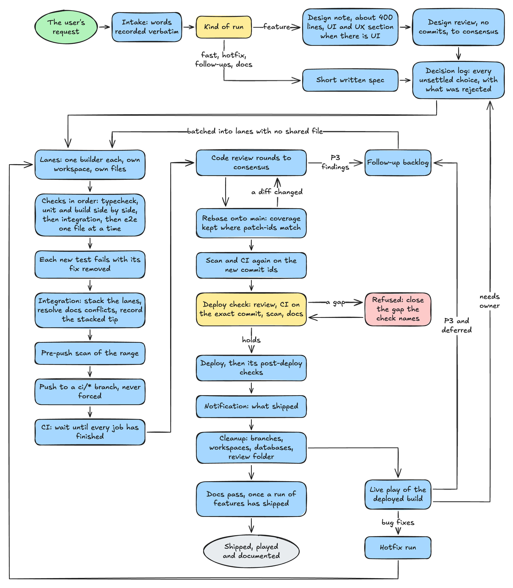
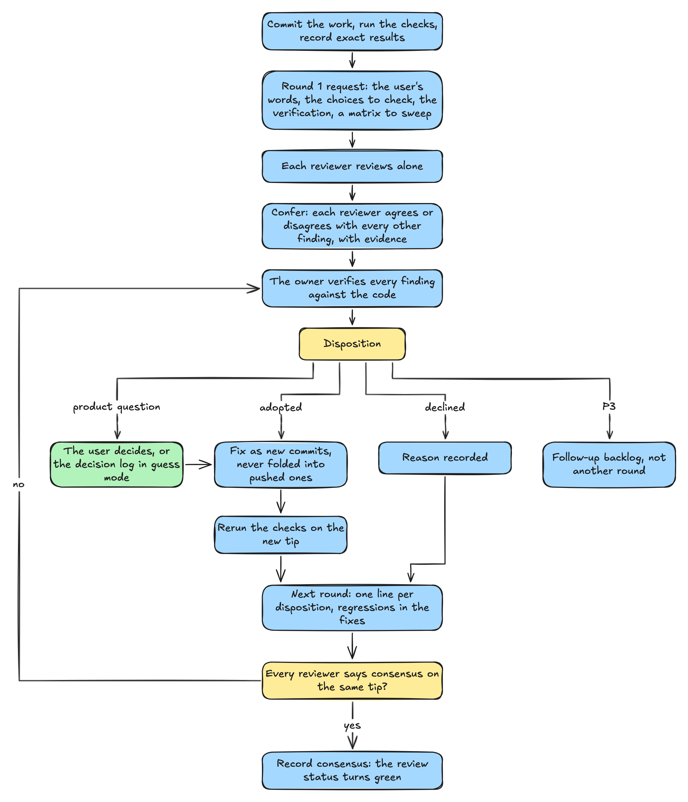
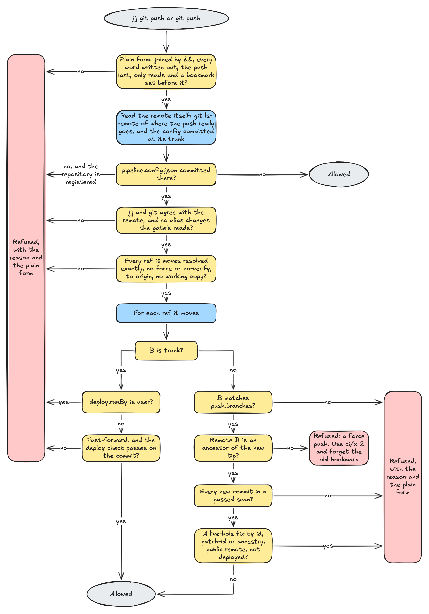
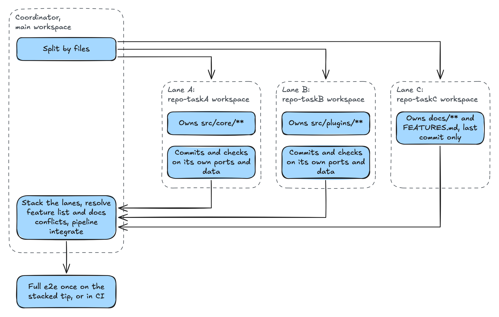

# agent-pipeline

A delivery process for agent teams, written down and made checkable. A coordinating agent takes a user's request through design, design review, a parallel build, code review, CI, deploy, live play of the deployed build, follow-ups and docs, with other agents doing the work at each stage.

It fits any software. Live play, for one, means exercising a running copy of the deployed commit the way its real users or clients would, beyond the automated tests, and fixing what breaks: several users in separate sessions for a web app, real clients for an API, real commands for a CLI, a small consumer app for a library, a device or emulator for a mobile app. It runs on an isolated instance, never production. Steps that fit only some software, such as a UI and UX section, user docs and screenshots, stay off until a project's config turns them on.

The `pipeline` CLI records each stage in a ledger, the way agent-review records reviews. It mirrors each stage to GitHub as a commit status (`pipeline/design`, `pipeline/build`, `pipeline/scan`, `pipeline/ci`, `pipeline/deploy`, `pipeline/live-play`, `pipeline/docs` and others), and its gate refuses a step whose earlier stages have not passed: a push before the pre-push scan, a deploy before review consensus and green CI on the exact commit, a code review before the build passed.

The gate is a guardrail for cooperative agents, not a security boundary. It stops an agent that makes an honest mistake from deploying, pushing, taking a pull request out of draft or merging without the review it needs. It does not try to stop an agent working to get around it. That rests on branch protection, required status checks, deploy keys and environment protection rules, and a repository that needs a hard boundary must set them: [docs/integration.md](docs/integration.md#7-what-the-gate-is-for) says what the gate is for and lists the settings.

## How it works

<picture>
  <source media="(prefers-color-scheme: dark)" srcset="docs/images/flow-dark.png">
  
</picture>

From the user's request to shipped and documented. [Details](docs/diagrams.md#1-from-request-to-shipped-and-documented).

<picture>
  <source media="(prefers-color-scheme: dark)" srcset="docs/images/review-loop-dark.png">
  
</picture>

The review round loop. [Details](docs/diagrams.md#3-the-review-round-loop).

<picture>
  <source media="(prefers-color-scheme: dark)" srcset="docs/images/gate-dark.png">
  
</picture>

What the gate does with a push. [Details](docs/diagrams.md#7-what-the-gate-does-with-a-push).

<picture>
  <source media="(prefers-color-scheme: dark)" srcset="docs/images/lanes-dark.png">
  
</picture>

Parallel lanes and their ownership. [Details](docs/diagrams.md#4-parallel-lanes-and-their-ownership).

## Read

- [docs/process.md](docs/process.md): the process, stage by stage, and why each rule exists.
- [docs/diagrams.md](docs/diagrams.md): the flow, each stage's states, the review loop, parallel lanes, the hotfix lane and the live play loop.
- [docs/stages.md](docs/stages.md): what the tool checks at each stage, and which steps stay judgment calls with a recorded sign-off.
- [docs/config.md](docs/config.md): `pipeline.config.json`.
- [docs/integration.md](docs/integration.md): installing on another machine, for Claude Code, Codex, or an agent without hooks, and running code review without agent-review.
- [profiles/raccoon-vtt](profiles/raccoon-vtt/): the project this came from, a self-hosted web app, as a worked example. Its project-specific settings live there and nowhere else.
- [templates](templates/): the shared preamble, brief templates and a design note skeleton.

## Install

```sh
git clone git@github.com:jwhitlow45/agent-pipeline.git ~/src/agent-pipeline
~/src/agent-pipeline/install.sh            # puts pipeline on PATH
~/src/agent-pipeline/install.sh --codex    # Codex skill and hooks
cd ~/src/my-app && pipeline init           # a project's config
```

In Claude Code:

```
/plugin marketplace add jwhitlow45/agent-pipeline
/plugin install agent-pipeline@agent-pipeline
```

It needs Node 22 or later, jj, git and an authenticated `gh`. It has no dependencies.

## A run, start to finish

```sh
pipeline intake --run dark-mode --kind feature --ui --words-file request.txt
pipeline design --run dark-mode --note docs/design-dark-mode.md --review-topic dark-modedesign
# design review with no commits, to consensus, then:
pipeline design --run dark-mode --note docs/design-dark-mode.md
pipeline lane --run dark-mode --lane a --workspace ../my-app-dark-a --owns 'src/theme/**' --brief briefs/dark-a.md
pipeline commits --run dark-mode --lane a
pipeline check --run dark-mode --lane a --e2e settings
pipeline mutation --run dark-mode --lane a --commit <rev> --test src/theme/theme.test.ts
pipeline report --run dark-mode --lane a --file reports/dark-a.md
pipeline signoff --run dark-mode --stage build --item scope --by coordinator --note "one commit per item"
pipeline build --run dark-mode --review-topic dark-modebuild
pipeline scan --run dark-mode
jj bookmark set ci/dark-mode -r <tip> && jj git push --bookmark ci/dark-mode
pipeline ci --run dark-mode --wait
# code review rounds to consensus (agent-review, or pipeline review), then:
pipeline deploy check --run dark-mode
pipeline deploy record --run dark-mode --name batch-12 --shipped "dark mode" --health healthy
pipeline cleanup --run dark-mode
pipeline live-play start --run dark-mode --prefix LP1
pipeline status --run dark-mode
```

## Layout

- `bin/pipeline`, `bin/pipeline.mjs`: the CLI.
- `lib/`: the ledger, stages, gate, scan, checks runner and GitHub mirror.
- `test/`: `npm test` runs every test with `node --test`, against temporary repositories and a stubbed `gh`.
- `.claude-plugin/`, `hooks/`, `skills/`: the Claude Code plugin and its marketplace.
- `codex/`: the AGENTS.md section and hooks for Codex.
- `git-hooks/pre-push`: the push checks for plain `git push`.
- `install.sh`, `pipeline.config.example.json`.
