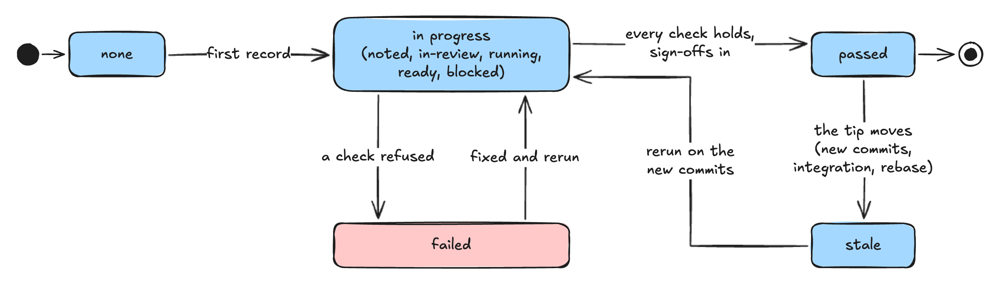
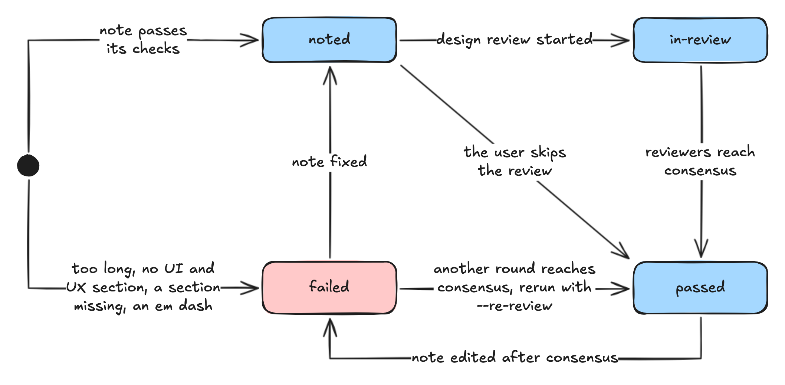
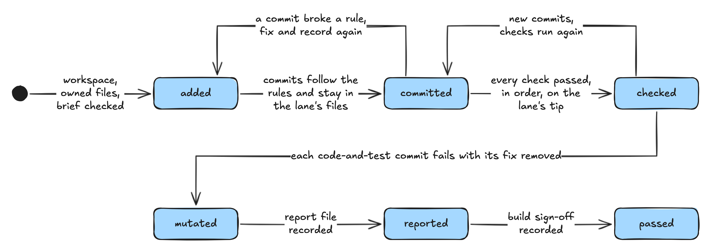
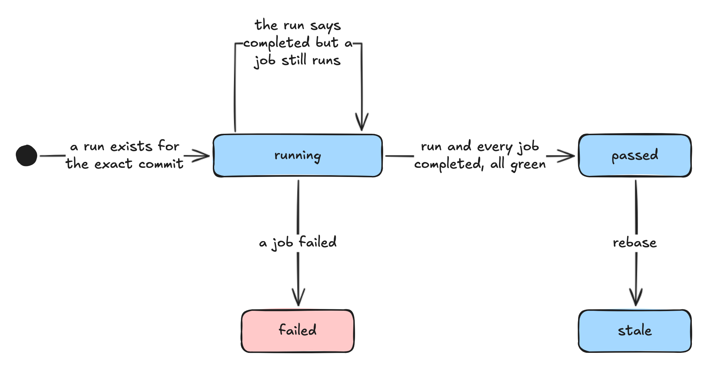
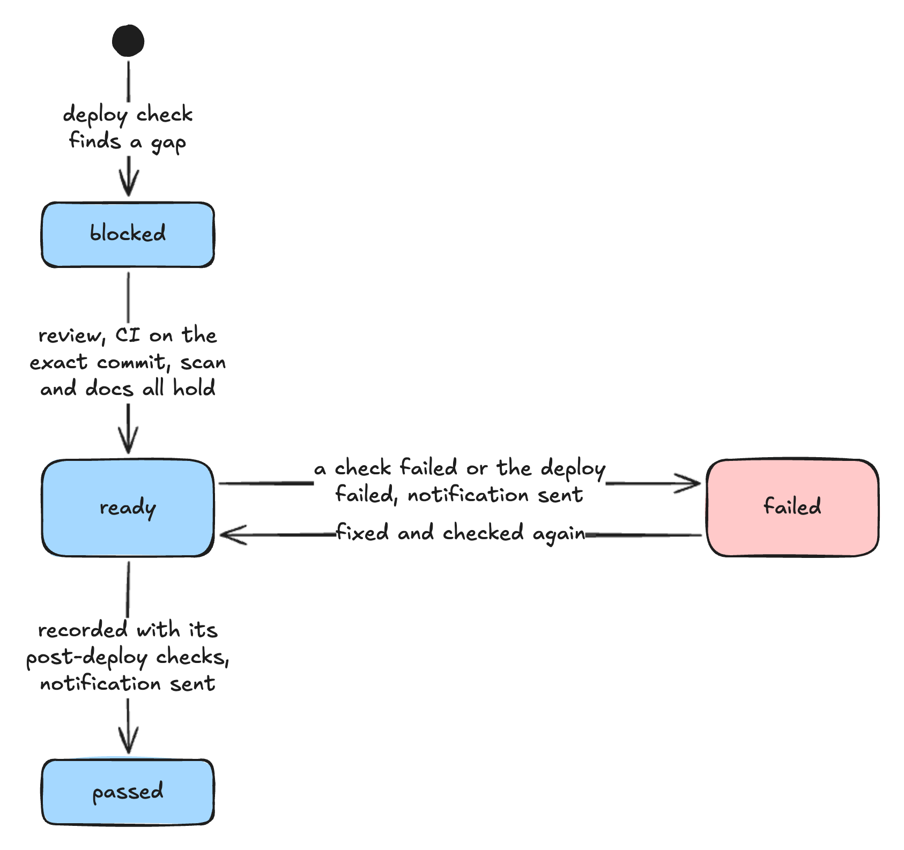
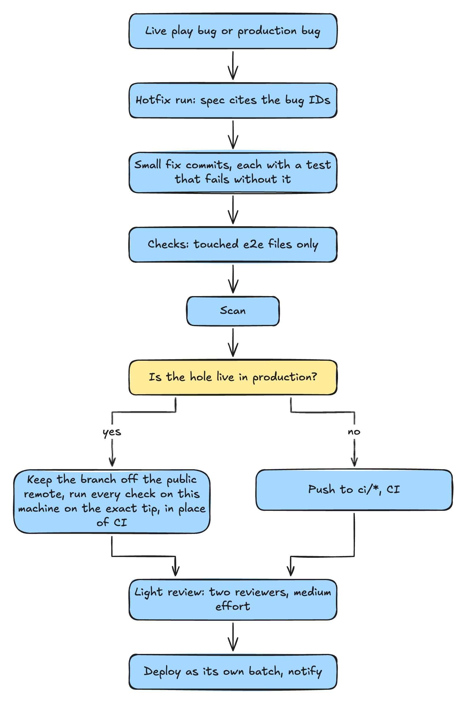
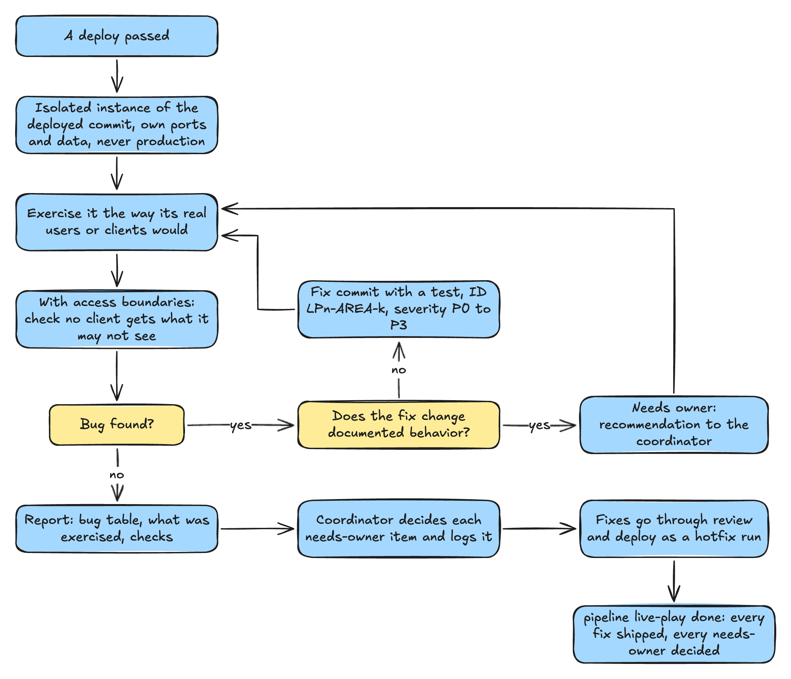
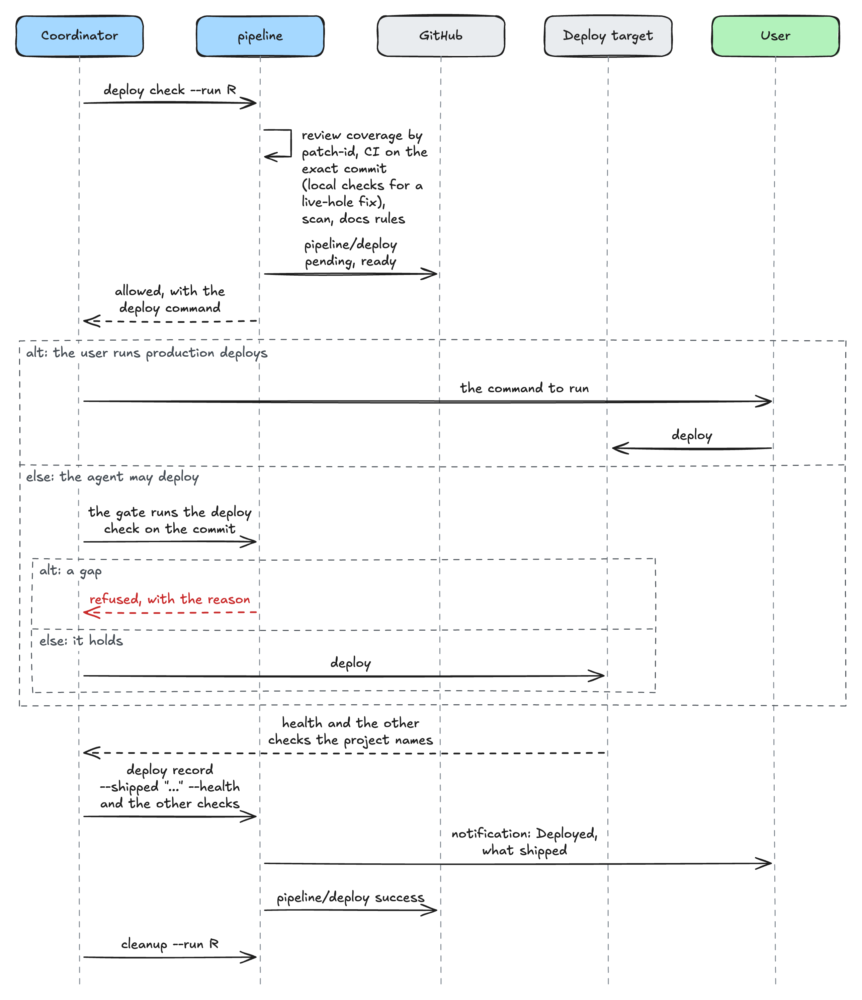

# Diagrams

Each diagram below is an image rendered from an [Excalidraw](https://excalidraw.com) drawing in [diagrams](diagrams/). To edit one, open its `.excalidraw` file in excalidraw.com or in the VS Code Excalidraw extension, and save it in place. Then run `node scripts/render-diagrams.mjs` to render the light and dark images again. Add a drawing's name, such as `flow`, to render only that one. The script needs network access for `npm` and Google Chrome or Playwright's Chromium. `npm test` fails when an image is out of date.

[process.md](process.md) explains each step in prose, and [stages.md](stages.md) lists what the tool checks at each one.

## 1. From request to shipped and documented

<picture>
  <source media="(prefers-color-scheme: dark)" srcset="images/flow-dark.png">
  
</picture>

Source: [diagrams/flow.excalidraw](diagrams/flow.excalidraw).

## 2. A stage's states

Every stage moves through the same states in the ledger. The GitHub status follows: `success` for passed or skipped, `failure` for failed, `pending` for anything in between.

<picture>
  <source media="(prefers-color-scheme: dark)" srcset="images/stage-states-dark.png">
  
</picture>

Source: [diagrams/stage-states.excalidraw](diagrams/stage-states.excalidraw).

### Design

<picture>
  <source media="(prefers-color-scheme: dark)" srcset="images/design-dark.png">
  
</picture>

Source: [diagrams/design.excalidraw](diagrams/design.excalidraw).

### Build lane

<picture>
  <source media="(prefers-color-scheme: dark)" srcset="images/build-lane-dark.png">
  
</picture>

Source: [diagrams/build-lane.excalidraw](diagrams/build-lane.excalidraw).

### CI

<picture>
  <source media="(prefers-color-scheme: dark)" srcset="images/ci-dark.png">
  
</picture>

Source: [diagrams/ci.excalidraw](diagrams/ci.excalidraw).

### Deploy

<picture>
  <source media="(prefers-color-scheme: dark)" srcset="images/deploy-dark.png">
  
</picture>

Source: [diagrams/deploy.excalidraw](diagrams/deploy.excalidraw).

## 3. The review round loop

<picture>
  <source media="(prefers-color-scheme: dark)" srcset="images/review-loop-dark.png">
  
</picture>

Source: [diagrams/review-loop.excalidraw](diagrams/review-loop.excalidraw).

## 4. Parallel lanes and their ownership

<picture>
  <source media="(prefers-color-scheme: dark)" srcset="images/lanes-dark.png">
  
</picture>

Source: [diagrams/lanes.excalidraw](diagrams/lanes.excalidraw).

`pipeline lane` refuses a lane whose globs match a file another open lane owns. `pipeline commits` refuses a commit that touches another open lane's file, a new file included, unless the coordinator acknowledges it with `--outside`.

## 5. The hotfix fast lane

<picture>
  <source media="(prefers-color-scheme: dark)" srcset="images/hotfix-dark.png">
  
</picture>

Source: [diagrams/hotfix.excalidraw](diagrams/hotfix.excalidraw).

## 6. The live play loop

<picture>
  <source media="(prefers-color-scheme: dark)" srcset="images/live-play-dark.png">
  
</picture>

Source: [diagrams/live-play.excalidraw](diagrams/live-play.excalidraw).

## 7. What the gate does with a push

<picture>
  <source media="(prefers-color-scheme: dark)" srcset="images/gate-dark.png">
  
</picture>

Source: [diagrams/gate.excalidraw](diagrams/gate.excalidraw).

## 8. A deploy, step by step

<picture>
  <source media="(prefers-color-scheme: dark)" srcset="images/deploy-steps-dark.png">
  
</picture>

Source: [diagrams/deploy-steps.excalidraw](diagrams/deploy-steps.excalidraw).
