# Diagrams

GitHub renders these Mermaid diagrams in place. [process.md](process.md) explains each step in prose, and [stages.md](stages.md) lists what the tool checks at each one.

## 1. From request to shipped and documented

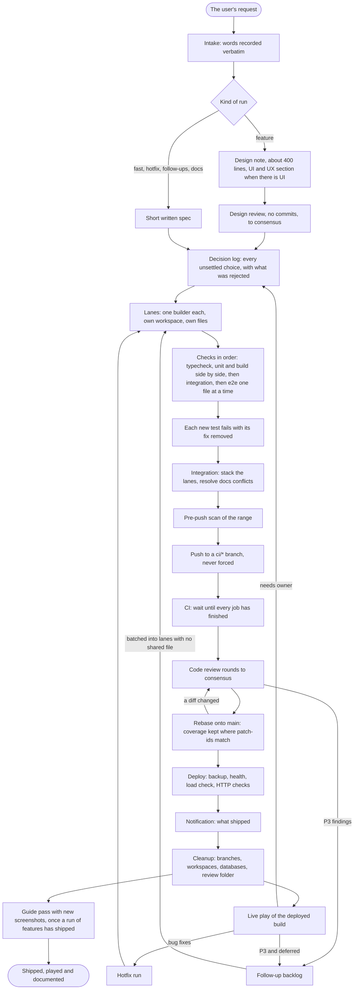

## 2. A stage's states

Every stage moves through the same states in the ledger. The GitHub status follows: `success` for passed or skipped, `failure` for failed, `pending` for anything in between.

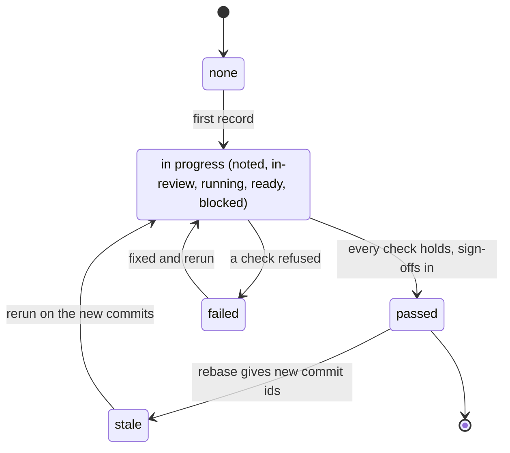

### Design

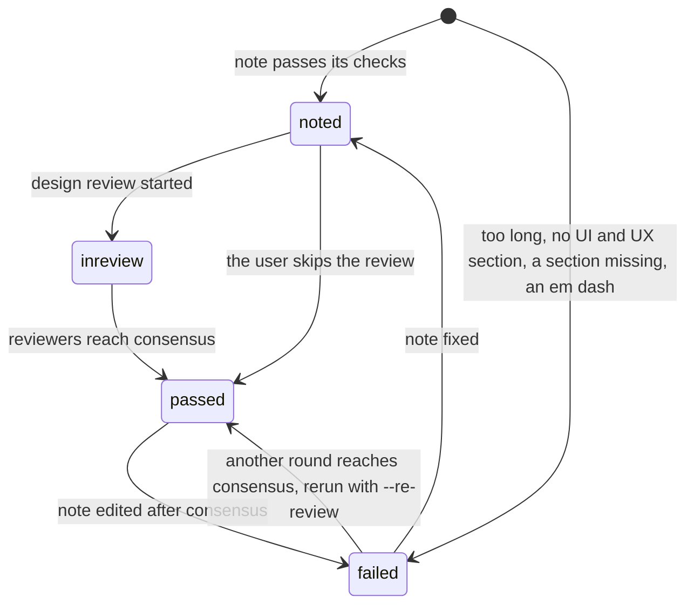

### Build lane

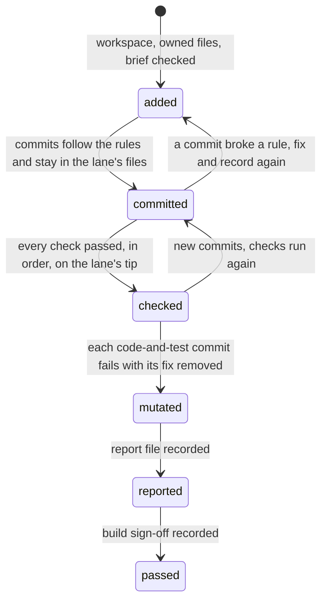

### CI

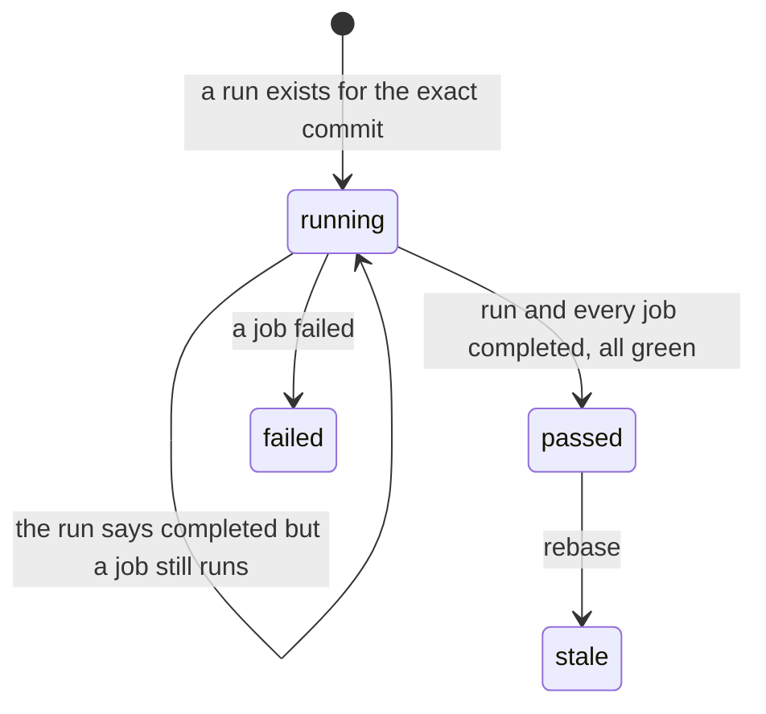

### Deploy

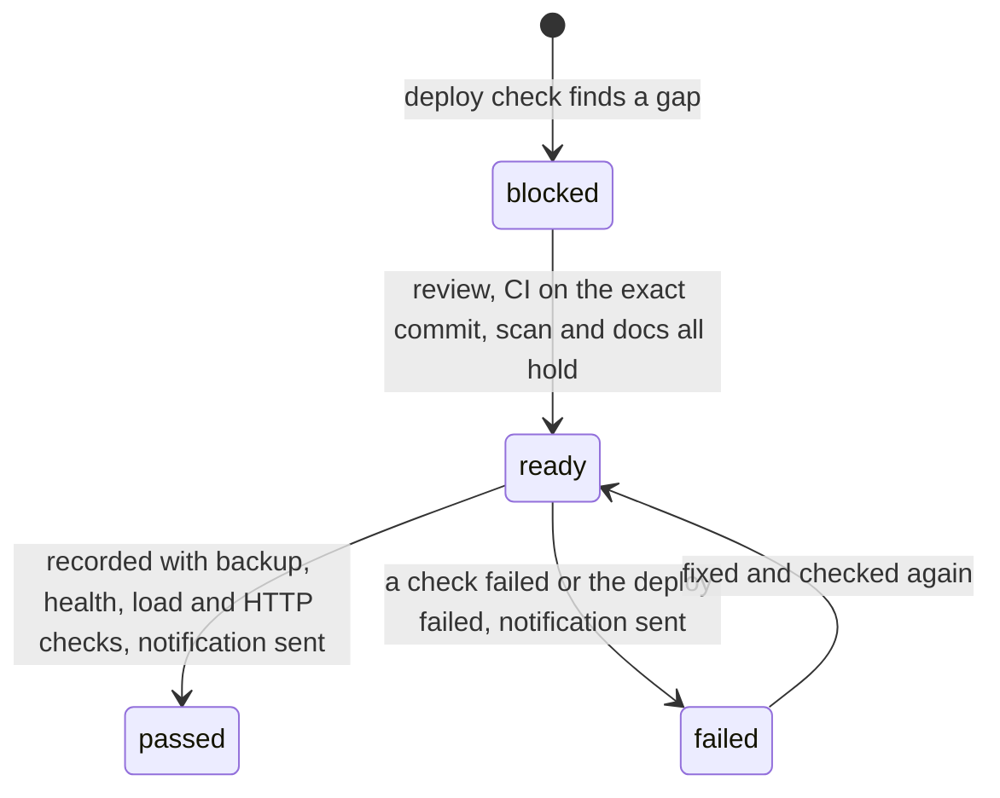

## 3. The review round loop

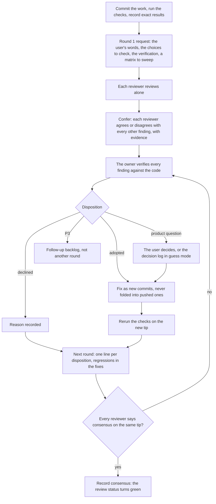

## 4. Parallel lanes and their ownership

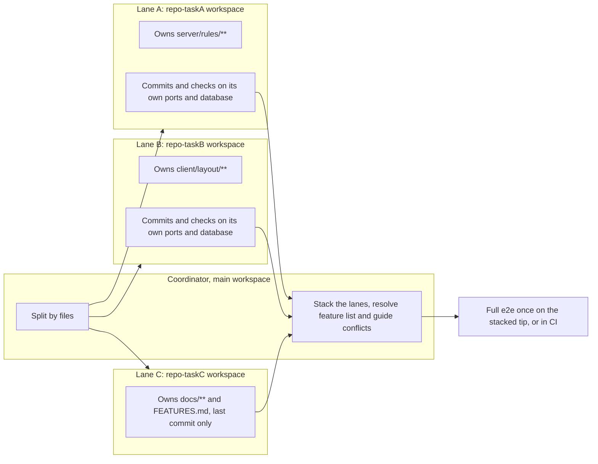

`pipeline lane` refuses a lane whose globs match a file another open lane owns. `pipeline commits` refuses a commit that touches another open lane's file, a new file included, unless the coordinator acknowledges it with `--outside`.

## 5. The hotfix fast lane

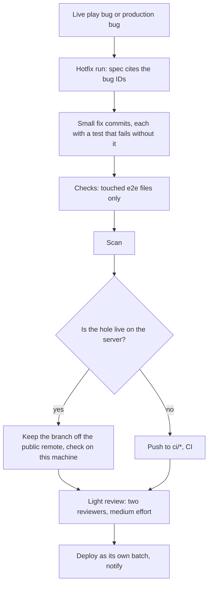

## 6. The live play loop

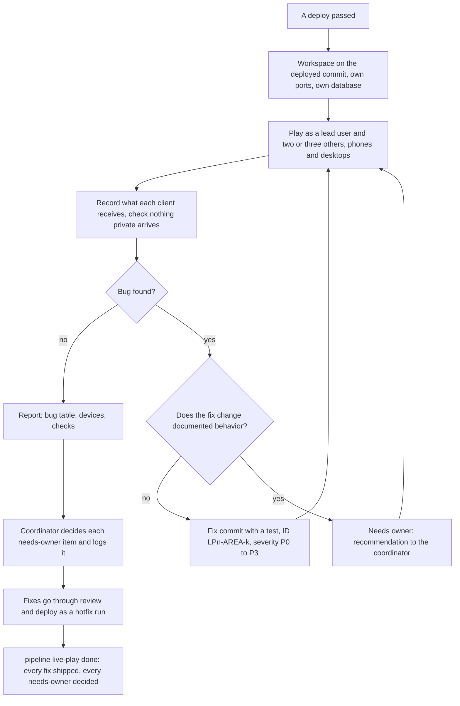

## 7. What the gate does with a push

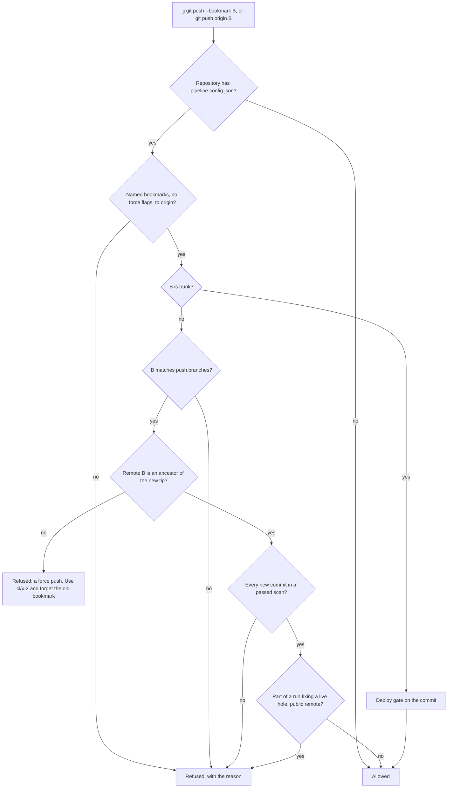

## 8. A deploy, step by step

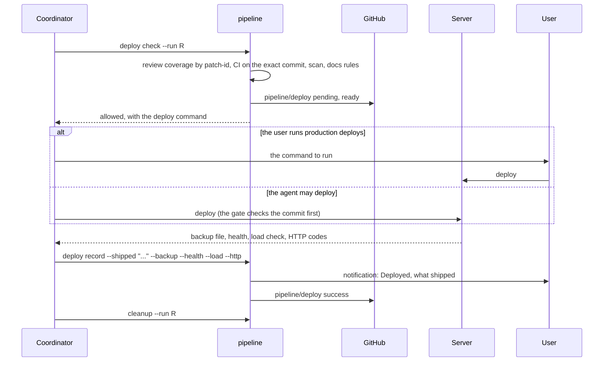
